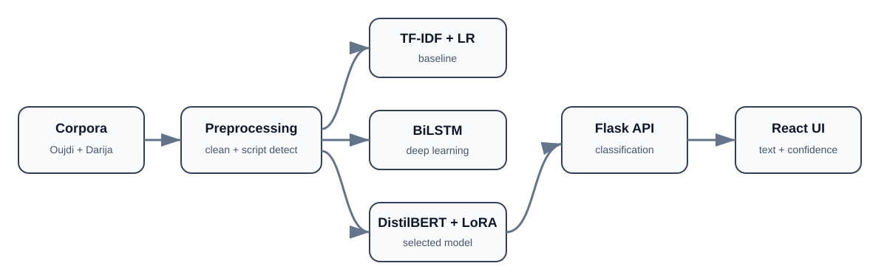

# Oujdi Dialect Classifier

An end-to-end NLP system that classifies short text as either **Oujdi**, the dialect spoken in Eastern Morocco, or **general Moroccan Darija**. The project compares classical machine learning, deep learning, and transformer-based approaches, then exposes the selected model through a Flask API and React interface.


## Architecture



The project separates corpus preparation, model experimentation, inference, and the user interface. Three model families were evaluated under the same binary-classification objective before the transformer-based configuration was selected for the application path.

## Project overview

Moroccan Darija contains important regional variation, while many NLP resources treat it as one broad language variety. This project explores that limitation by distinguishing Oujdi text from general Moroccan Darija across Arabic, Latin, and mixed scripts.

The system includes:

- data preparation and text cleaning;
- Arabic/Latin/mixed-script detection;
- TF-IDF + Logistic Regression baseline;
- Bidirectional LSTM model;
- multilingual DistilBERT fine-tuned with LoRA;
- Flask prediction API;
- React classification interface;
- evaluation reports and research visualizations.

## Dataset

The final classification dataset contains **100,000 balanced samples**:

| Class | Samples |
|---|---:|
| Oujdi | 50,000 |
| Moroccan Darija | 50,000 |
| **Total** | **100,000** |

The Moroccan Darija portion was prepared from the Darija Open Dataset. The Oujdi portion was prepared from a larger 220,000-line corpus created by the project team.

## Model results

| Model | Test accuracy |
|---|---:|
| TF-IDF + Logistic Regression | 93.40% |
| Bidirectional LSTM | 95.20% |
| **DistilBERT + LoRA** | **97.59%** |

The DistilBERT + LoRA configuration produced the strongest reported test accuracy in the project experiments.

## Technology stack

- **Languages:** Python, JavaScript
- **Machine Learning:** Scikit-learn, TensorFlow, PyTorch
- **NLP:** Hugging Face Transformers, PEFT, LoRA
- **Backend:** Flask, Flask-CORS
- **Frontend:** React, Vite
- **Data:** Pandas, NumPy
- **Visualization:** Matplotlib, Seaborn

## Repository structure

```text
.
├── data/                  # prepared classification dataset
├── frontend/              # React/Vite interface
├── models/                # trained models and tokenizer files
├── src/                   # training, evaluation and API scripts
├── report_figures/        # main research figures
├── advanced_figures/      # additional evaluation figures
├── docs/                  # architecture documentation
└── RAPPORT_PROJECT_DL.pdf # full academic report
```

## Local setup

### Backend

```bash
python -m venv .venv
```

Activate the environment, then:

```bash
pip install -r requirements.txt
python src/api.py
```

The API runs at `http://127.0.0.1:5001`.

### Frontend

```bash
cd frontend
npm install
npm run dev
```

## API endpoints

```text
GET  /health
POST /classify
```

Example request:

```json
{
  "text": "واش غادي تجي اليوم؟"
}
```

The response includes the predicted class, confidence, and class probabilities.

## Contributions

Chaima Menouar's contributions included:

- dataset preparation and cleaning;
- model training and evaluation;
- Flask backend development;
- React interface development;
- research report and evaluation figures.

## Team

Developed by **Chaima Menouar** and **Mohammed Oulhadj** under the supervision of **Prof. Mohamed Cherradi**.

## Research report

The complete methodology, experiments, results, and discussion are available in [`RAPPORT_PROJECT_DL.pdf`](RAPPORT_PROJECT_DL.pdf).

## Data attribution

The Moroccan Darija portion is derived from the Darija Open Dataset and remains subject to its CC BY-NC 4.0 license. The Oujdi corpus was created by the project team; contact the authors before reuse or redistribution.

## Limitations

- binary classification only;
- very short or ambiguous text can be difficult to classify reliably;
- regional dialect boundaries overlap in vocabulary and spelling;
- reported results describe the project dataset and should not be interpreted as universal dialect-recognition accuracy;
- the project is intended for research and educational use.
