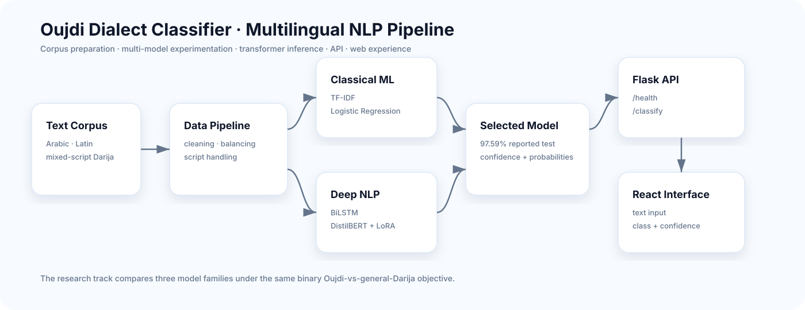

<div align="center">

# Oujdi Dialect Classifier

### Regional Moroccan-Darija classification across Arabic, Latin & mixed scripts

**TF-IDF · BiLSTM · DistilBERT + LoRA · Flask · React · multilingual NLP**


</div>

An end-to-end NLP system that classifies short text as either **Oujdi** (Eastern Moroccan dialect) or **general Moroccan Darija**. The project compares classical machine learning, deep learning and transformer-based approaches before exposing the selected model through a Flask API and React interface.

## Architecture



The research pipeline keeps corpus preparation, experimentation, model selection, inference and user experience separate.

## Why this project matters

Moroccan Darija contains important regional variation, while many NLP resources treat it as one broad language variety. This project explores that gap by distinguishing Oujdi text from general Moroccan Darija across **Arabic, Latin and mixed-script writing**.

## Dataset

The final classification dataset contains **100,000 balanced samples**:

| Class | Samples |
|---|---:|
| Oujdi | 50,000 |
| Moroccan Darija | 50,000 |
| **Total** | **100,000** |

The Moroccan Darija portion was prepared from the Darija Open Dataset. The Oujdi portion was prepared from a larger **220,000-line corpus created by the project team**.

## Model comparison

| Model | Test accuracy |
|---|---:|
| TF-IDF + Logistic Regression | 93.40% |
| Bidirectional LSTM | 95.20% |
| **DistilBERT + LoRA** | **97.59%** |

The DistilBERT + LoRA configuration achieved the strongest reported test accuracy in the project experiments.

## System capabilities

- dataset preparation and text cleaning;
- Arabic/Latin/mixed-script handling;
- TF-IDF + Logistic Regression baseline;
- Bidirectional LSTM experiment;
- multilingual DistilBERT fine-tuned with LoRA;
- Flask prediction API;
- React classification interface;
- research figures and evaluation report.

## API

```text
GET  /health
POST /classify
```

Example:

```json
{
  "text": "واش غادي تجي اليوم؟"
}
```

The response includes predicted class, confidence and class probabilities.

## Local setup

### Backend

```bash
python -m venv .venv
pip install -r requirements.txt
python src/api.py
```

API: `http://127.0.0.1:5001`

### Frontend

```bash
cd frontend
npm install
npm run dev
```

## Technology stack

`Python` · `Scikit-learn` · `TensorFlow` · `PyTorch` · `Hugging Face Transformers` · `PEFT/LoRA` · `Flask` · `React` · `Pandas` · `NumPy`

## Repository structure

```text
data/                  prepared classification dataset
frontend/              React/Vite interface
models/                model/tokenizer files
src/                   training, evaluation and API scripts
report_figures/        main research figures
advanced_figures/      additional evaluation figures
docs/                  architecture documentation
RAPPORT_PROJECT_DL.pdf full academic report
```

## My contributions

Chaima Menouar contributed to:

- dataset preparation and cleaning;
- model training and evaluation;
- Flask backend development;
- React interface development;
- report writing and evaluation figures.

## Team

Developed by **Chaima Menouar** and **Mohammed Oulhadj** under the supervision of **Prof. Mohamed Cherradi**.

## Limitations

- binary classification only;
- short or ambiguous text can remain difficult;
- regional dialect boundaries overlap in vocabulary and spelling;
- reported metrics describe the project dataset and are not universal dialect-recognition accuracy;
- research/educational use only.

## Research report

Full methodology, experiments and discussion: [`RAPPORT_PROJECT_DL.pdf`](RAPPORT_PROJECT_DL.pdf).
